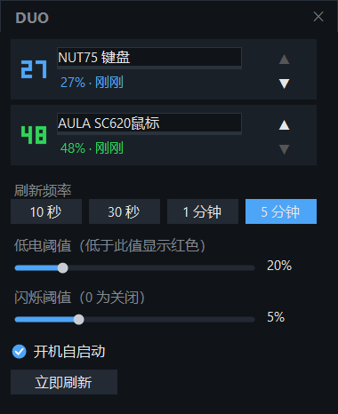

# DUO

一个常驻系统托盘的双设备电量监视器：NUT75 键鼠 + AULA（狼蛛）SC620 鼠标，电量直接画成托盘里的点阵数字，低电变红、临近关机开始闪烁。

单文件、免安装、零第三方依赖——一个 137 KB 的 `DUO.exe` 加一份配置就能跑，删掉即完全卸载。


## 截图



## 特性

- **双设备同屏**：两个托盘图标，各自显示实时电量数字，互不干扰
- **点阵图标**：3×5 像素字渲染，随 DPI（100% / 125% / 150%）自动缩放，边缘锐利
- **颜色语义**：蓝 = NUT75 电量充足或充电中，绿 = SC620 充足或充电中，红 = 低于低电阈值，灰 = 未连接
- **低电闪烁**：电量 ≤ 闪烁阈值且未充电时图标明暗交替；阈值可设 0 关闭
- **充电识别**：NUT75 读硬件充电标志；SC620 无该标志，按电量趋势推断（连续两次跳升才判定，防 ±1 抖动误报）
- **便携零残留**：配置写在 exe 同目录的 `duo.json`，不碰 AppData / 注册表（自启动项除外）
- **可定制**：设备重命名、托盘图标排序、刷新频率（10 秒 / 30 秒 / 1 分钟 / 5 分钟）
- **开机自启动**：写入 `HKCU\Software\Microsoft\Windows\CurrentVersion\Run`，每次启动自动修正路径，exe 搬家也不失效
- **单实例**：重复启动只唤醒已有窗口，不会出现两份托盘
- **Win11 托盘提升**：自动把自己从折叠区提升到任务栏，并清理旧版本留下的失效条目

## 支持的设备

| 设备 | VID | PID | 命令通道 | 说明 |
| --- | --- | --- | --- | --- |
| NUT75 键鼠接收器 | `0x0C45` | `0xFEF9` | usagePage `0xFF60` | 必须同时打开设备全部 HID 集合才会应答；句柄常驻缓存 |
| AULA / 狼蛛 SC620 | `0xA8A5` | `0x2255` | usagePage `0xFF01` | 单通道、无需握手，每次轮询新开新关 |

两套 HID 协议均为实测逆向所得，请求帧均为 64 字节、写入时前置 `0x00` 作为 report ID。

## 系统要求

- Windows 10 1903+ 或 Windows 11，x64
- .NET Framework 4.8（Win10 1903 之后及 Win11 均系统自带，无需额外安装）
- 无需管理员权限

## 构建

仓库不含可执行文件，自行编译只需一条命令：

```bat
build.cmd
```

`build.cmd` 调用系统自带的 .NET Framework 编译器（`csc.exe`）直接产出 `DUO.exe`，无 NuGet 包、无 MSBuild、无 SDK 依赖。也可以手动执行：

```bat
%WINDIR%Microsoft.NETFramework644.0.30319csc.exe /nologo /utf8output /target:winexe /platform:x64 /optimize+ ^
  /win32icon:icon.ico ^
  /r:System.dll /r:System.Core.dll /r:System.Drawing.dll /r:System.Windows.Forms.dll /r:System.Web.Extensions.dll ^
  /out:DUO.exe Program.cs Native.cs Hid.cs Drivers.cs Config.cs TrayRenderer.cs DuoApp.cs MainForm.cs
```

成品可直接拷到任意 Windows x64 机器运行，不需要安装运行时。

## 使用

首次启动会打开主界面；关闭窗口只是隐藏，程序继续驻留托盘。

- **托盘左键**：打开主界面
- **托盘右键**：打开主界面 / 开机自启动 / 刷新频率 / 立即刷新 / 退出
- **主界面**：改设备名（回车保存，Esc 取消）、上下箭头调托盘顺序、拖动滑杆调阈值、「立即刷新」手动取一次

配置文件 `duo.json` 与 exe 同目录，可参照 `duo.example.json` 手改：

| 字段 | 类型 | 默认 | 说明 |
| --- | --- | --- | --- |
| `settings.refreshMs` | int | `30000` | 轮询间隔，仅接受 10000 / 30000 / 60000 / 300000 |
| `settings.lowThreshold` | int | `20` | 低电阈值（1–99），低于此值显示红色 |
| `settings.flashThreshold` | int | `5` | 闪烁阈值（0 关闭），必须小于低电阈值 |
| `settings.autostart` | bool | `false` | 是否随系统启动（带 `--hidden`，不弹窗） |
| `settings.trayOrder` | string[] | `["nut75","sc620"]` | 托盘图标从左到右的顺序 |
| `devices.<id>.name` | string | 设备默认名 | 自定义名称，最长 24 字符 |
| `devices.<id>.icon` | string | `null` | 预留字段 |

配置缺失或损坏时会自动回落到默认值，不会崩溃。

## 目录结构

```
.
├── build.cmd          # 一键编译（csc）
├── Program.cs         # 入口：DPI 感知、单实例互斥
├── DuoApp.cs          # 托盘管理、轮询线程、充电推断、自启动、托盘提升
├── MainForm.cs        # 无边框深色主界面（含自绘滑杆 / 勾选框）
├── TrayRenderer.cs    # 点阵数字图标渲染
├── Drivers.cs         # 两台设备的协议实现
├── Hid.cs             # HID 枚举 + 重叠 IO 读写
├── Native.cs          # 全部 Win32 P/Invoke
├── Config.cs          # duo.json 读写
├── icon.ico           # 程序图标
└── duo.example.json   # 配置示例
```

## 常见问题

**首次运行被 SmartScreen 拦下？**
exe 没有代码签名，Windows 会提示"已保护你的电脑"。点「更多信息」→「仍要运行」即可。源码全部公开，也可以自己 `build.cmd` 编译。

**电量一直显示 -- / 未连接？**
确认接收器已插好、设备已开机配对。若同时开着别的电量工具（例如旧版 Electron 实现、`monitor` 等）在轮询同一设备，两者会抢 HID 句柄，建议只保留一个。

**NUT75 突然读不到电量，但键鼠还能用？**
强杀进程可能把接收器的配置协议卡死（输入报表正常、命令通道超时），软件端无法自救，重新插拔接收器即可恢复。

**SC620 显示充电中但实际没插线？**
SC620 没有硬件充电标志，充电状态由电量趋势推断（连续两次上升才判定）。轻微读数抖动时会短暂误判，属正常现象；想要更保守可以把刷新频率调高。

**托盘图标被折叠进「^」里？**
程序会尝试把自身提升到任务栏（写 `HKCU\Control Panel\NotifyIconSettings`）。若仍被折叠，手动拖出来一次，Windows 会记住位置。

**换台电脑 / 移动 exe 后配置丢了？**
配置跟着 exe 走。把 `DUO.exe` 和 `duo.json` 一起拷走即可；自启动路径会在下次启动时自动修正。

## 已知限制

- 仅支持上面表格里的两个 VID/PID，不支持任意 HID 设备（协议是逐设备逆向的）
- 仅 x64 Windows；不支持 ARM64、Linux、macOS
- 设备固件升级后协议可能变化，需要重新抓包适配

## 免责声明

本项目是非官方第三方工具，与 NUT75、AULA / 狼蛛 厂商无关。HID 协议来自对自有设备的实测逆向，仅读取电量，不修改设备配置、不写入固件。使用风险自负。

## 许可证

[MIT](LICENSE) © 2026 Dhhh2026
